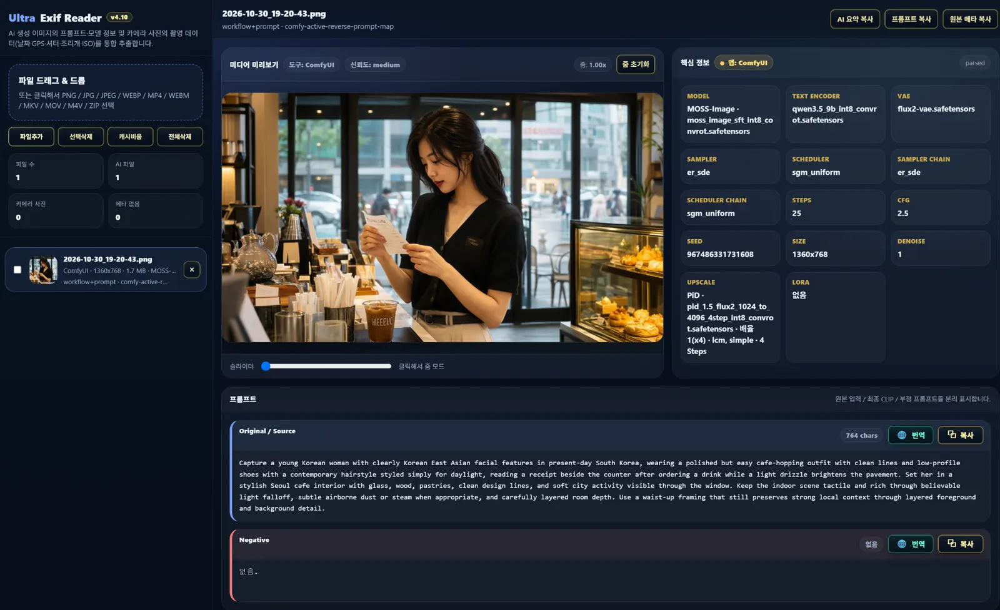

# Ultra Exif Reader v4.13

**EXIF·AI 이미지/영상 메타데이터 분석기 | EXIF & AI Image/Video Metadata Reader**

사진의 촬영 정보부터 AI 생성 이미지·영상에 저장된 **모델, 프롬프트, Seed, LoRA, ComfyUI 워크플로우**까지 확인하는 무료 브라우저 도구입니다. 별도 설치 프로그램이나 자체 서버 없이 HTML 파일을 Chrome 또는 Edge에서 실행할 수 있습니다.

> **English:** A free, browser-based EXIF and AI generation metadata reader for images and videos, including ComfyUI workflows, prompts, models, LoRA, and sampling settings. [English guide ↓](#english)

### 📸 프로그램 화면 / Application preview

*Ultra Exif Reader 화면 예시 — 이미지 미리보기, 생성 모델·텍스트 인코더·VAE·Seed·Steps·PiD 업스케일 및 프롬프트 확인*

### 🌐 한국어 / English UI (v4.11)

앱 제목 옆의 **KO / EN 토글**로 한국어와 영어 화면을 즉시 전환할 수 있습니다. 금색 강조로 현재 선택된 언어를 표시하며, 브라우저에 선택 언어가 기억됩니다.

- 한국어(KO) 기본 시작, 영어(EN) 메뉴·도움말·카메라 탭·이미지 분석창 지원
- 파일을 다시 분석하지 않고 화면 문구만 변경
- **모델·VAE·LoRA·Seed·Steps·프롬프트 원문·분석 결과는 절대 번역하거나 수정하지 않음**
- 기존 프롬프트 번역 기능은 한국어 번역으로 유지
- 427개 기존 메타데이터 비교에서 추출 결과 변경 0건, MOSS·Qwen·PiD 이미지 KO↔EN 복귀 검증

> **v4.11:** 한·영 전환 기능과 영문 안내문·오류 메시지 번역, 긴 영문 탭·버튼의 잘림 방지 개선이 최신 릴리즈 ZIP에 반영되었습니다. 한국어 UI와 원본 메타데이터는 그대로 유지됩니다.

**[📦 최신 버전 다운로드 / Download latest release](https://github.com/Yamoon-jjang/Ultra-Exif-Reader/releases/latest)** · **[📖 한국어 사용법](#다운로드-및-실행)** · **[⚠️ 제한 사항](#제한-사항)**

## 주요 기능

| 분류 | 지원 내용 |
|---|---|
| **카메라 EXIF** | 제조사·카메라·렌즈, 촬영 날짜, 셔터·조리개·ISO, 초점거리, GPS 등 |
| **AI 생성 메타데이터** | 기본 모델/Checkpoint/UNet, Text Encoder, VAE, LoRA, Seed, Steps, CFG, Sampler, Scheduler 등 |
| **ComfyUI 분석** | 이미지·영상에 포함된 prompt / workflow 정보, 연결된 생성 경로, 원본·최종·부정 프롬프트 구분 |
| **모델 및 커스텀 노드** | Qwen Image 2.1, MOSS-Image 등 다양한 ComfyUI 생성 구조에 저장된 메타데이터 분석 |
| **PiD 업스케일** | 검증된 PiD 업스케일 모델과 저장된 배율·Sampler·Scheduler·Steps 표시 |
| **이미지·영상·ZIP** | 지원 파일 형식의 메타데이터 분석 및 ZIP 내부 이미지·영상 불러오기 |
| **프롬프트 편의 기능** | 복사, 한국어 번역, 생성 단계별 표시, 저장된 프롬프트의 출처 구분 |
| **선택적 이미지 분석** | 생성 메타데이터가 없는 이미지를 Gemini, OpenAI GPT 또는 로컬 Ollama Vision으로 설명하고 새 영어 프롬프트 추정 |

**정확성 우선:** 확인되지 않거나 파일에 저장되지 않은 모델·프롬프트·Denoise 값은 임의로 만들어 표시하지 않습니다. 커스텀 노드 및 저장 형식에 따라 일부 정보는 추출되지 않을 수 있습니다.

## 다운로드 및 실행

1. **[Releases](https://github.com/Yamoon-jjang/Ultra-Exif-Reader/releases/latest)**에서 v4.13 배포 ZIP 파일을 다운로드합니다.
2. ZIP 압축을 풉니다.
3. **Ultra_exif_reader_v4.13.html**을 **Google Chrome** 또는 **Microsoft Edge**로 엽니다.
4. 이미지·영상·ZIP 파일을 앱 화면에 드래그하거나 **파일추가** 버튼을 누릅니다.
5. 오른쪽에서 핵심 정보, 프롬프트 및 원본 메타데이터를 확인합니다.

배포 ZIP에 포함된 **메뉴얼.txt**에서 상세 기능과 문제 해결 방법을 볼 수 있습니다. **기본 메타데이터 분석에는 API 키가 필요하지 않습니다.**

## 지원 파일 형식

| 구분 | 지원 형식 |
|---|---|
| 이미지 | PNG, JPG, JPEG, WebP |
| 영상 | MP4, WebM, MKV, MOV, M4V |
| 압축 | ZIP — 내부의 지원 이미지·영상 파일 불러오기 |

**참고:** 영상은 브라우저 코덱에 따라 미리보기가 제한될 수 있습니다. HEIC/HEIF, AVIF, GIF, TIFF, RAW 및 중첩 ZIP 등은 현재 직접 지원하지 않습니다.

## v4.13 주요 개선 사항

- **MiniMax H3 Chain 영상 지원:** 여러 장면을 이어 붙인 H3 Chain 영상에서 실행 기록(`h3_manifest`)을 읽어 장면별 **실제 프롬프트·Seed·Steps·생성/최종 프레임**을 표시 (프롬프트는 SHA-256 해시로 원문 검증)
- 공통 프롬프트와 장면별 프롬프트를 원문 그대로 구분 표시, 계획만 있는 장면(예: 24개 중 5~24번)은 실행 결과로 표시하지 않음
- 2^53을 넘는 큰 Seed도 끝자리까지 정확히 표시
- 영상 메타의 prompt JSON에 `NaN`이 들어 있어(일부 커스텀 노드) 통째로 버려지던 문제 수정 — 이미지(PNG)와 같은 결과로 표시
- 실행 기록이 없거나 손상된 H3 Chain 파일은 추측 값 대신 "확인 불가"로 표시
- H3 Chain 기록이나 `NaN` 값이 없는 파일은 v4.12와 동일하게 표시 (135개 파일 비교 중 해당 127개 파일의 내부 결과·화면 문구 변경 0건)

## v4.12 주요 개선 사항 (이전 버전)

- **실제 생성 프롬프트 표시:** Ultra Qwen Image Editor + PiD(v1.0.4+)·Ultra Image + PiD(v1.0.2+)가 이미지에 기록한 실제 프롬프트(`ultra_generation_prompts`)를 읽어 **Final CLIP**에 표시하고, 변환 전 원문은 **Original / Source**에 함께 표시
- 번역기·LLM 노드를 거친 프롬프트도 번역된 실제 문장 확인 가능 (PNG·JPEG·WebP)
- 기록이 없는 기존 이미지는 v4.11과 동일하게 표시

## v4.11 주요 개선 사항 (이전 버전)

- **English UI:** 영어 화면에서 일부 안내·상태·오류 메시지가 한국어로 표시되던 부분 보완
- **레이아웃:** 영어 명칭이 긴 EXIF 탭, 미디어 정보 패널, 버튼 등에서 잘림·넘침 개선
- **한국어 보존:** 기존 한글 UI 배치를 유지하고 메타데이터 판독·원본 프롬프트 처리 로직 변경 없음
- **배포 정비:** v4.11 HTML·사용 설명서 및 ZIP 패키지 버전 표기 통일

## v4.10 주요 개선 사항 (이전 버전)

- **ComfyUI 생성 정보:** MOSS-Image, Qwen Image 2.1 및 다양한 커스텀 생성 노드의 모델·VAE·Text Encoder 검출 보완
- **생성 Seed:** 와일드카드·프롬프트 처리 노드의 Seed와 실제 이미지 생성 Seed 구별
- **워크플로우 전용 메타데이터:** 이름 붙은 위젯 정보를 우선 사용하고 검증 가능한 생성 설정만 복원
- **PiD 업스케일:** 실제 저장 출력 경로와 설정을 확인해 모델 및 상세 정보 표시
- **텍스트 인코더:** 생성 Parameters의 명시적인 CLIP 모델 파일명 인식 개선
- **오검출 방지:** 다른 모델·LoRA·업스케일러 후보가 현재 생성 정보와 혼동되지 않도록 보호

## 개인정보 및 외부 연결

- **기본 파일 메타데이터 읽기:** 브라우저 안에서 처리하며, 이 작업을 위해 원본 파일 전체를 별도 분석 서버로 전송하지 않습니다.
- **AI 이미지 분석을 직접 실행하는 경우:** Gemini 또는 OpenAI로 선택한 이미지와 지시문이 전송됩니다. Ollama는 사용자 PC의 로컬 서버로 전송합니다.
- **프롬프트 번역:** 번역 서비스로 텍스트가 전송될 수 있습니다.
- **인터넷:** ExifReader와 pako 라이브러리를 CDN에서 불러오므로 일부 기본 기능에도 인터넷 연결이 필요할 수 있습니다.
- **API 키:** 저장을 선택하면 브라우저 localStorage에 보관될 수 있습니다. 공용 PC에서는 저장하지 마세요.

## 제한 사항

- 생성 파일에 메타데이터가 없거나 삭제된 경우 원래 모델·Seed·프롬프트를 확정적으로 복원할 수 없습니다.
- 이미지 분석은 보이는 내용을 바탕으로 **새 프롬프트를 추정**하는 기능이며 원본 프롬프트 복원과 다릅니다.
- 복잡한 커스텀 노드, 복수 생성 경로, 손상된 메타데이터에서는 일부 값이 누락되거나 모호할 수 있습니다.
- Denoise가 저장되지 않았다면 다른 Strength 값으로 추정하지 않고 공백으로 둡니다.
- 정확한 재현이 필요하면 원본 미디어와 ComfyUI 워크플로우 JSON을 함께 보관하세요.

오류나 누락을 발견했다면 재현 가능한 메타데이터 정보와 함께 **[Issues](https://github.com/Yamoon-jjang/Ultra-Exif-Reader/issues)**에 알려 주세요. 공개 이슈에 개인 정보, GPS, API 키 등이 포함된 원본을 올리지 않도록 주의해 주세요.

---

## English

**Ultra Exif Reader v4.13** is a free, browser-based tool for reading camera EXIF and AI generation metadata embedded in images and videos. It runs as a standalone HTML file in Chrome or Edge.

### Features

- **Camera EXIF:** Camera, lens, exposure, timestamps, and GPS information.
- **AI generation metadata:** Model/checkpoint, UNet, text encoders, VAE, LoRA, Seed, Steps, CFG, Sampler, and Scheduler (when embedded in the file).
- **ComfyUI:** Stored workflow and prompt information, generation paths, positive/negative/source prompts, and compatible custom nodes.
- **Model support:** Qwen Image 2.1, MOSS-Image, PiD upscaling metadata, and other supported structures.
- **Formats:** PNG, JPEG, WebP; supported MP4, WebM, MKV, MOV, M4V videos; and ZIP archives containing supported media.
- **Optional tools:** Prompt translation and image-to-prompt analysis using Gemini, OpenAI GPT, or local Ollama Vision.
- **MiniMax H3 Chain videos (v4.13):** Reads the execution record (`h3_manifest`) of multi-scene H3 Chain videos and shows each executed scene's prompt (SHA-256 verified), Seed (exact, including values above 2^53), Steps and generated/final frames. Planned-only scenes are never shown as results. Video prompt JSON containing `NaN` tokens is now read instead of being discarded.
- **Executed prompt record (v4.12):** Shows the real prompt recorded by Ultra Qwen Image Editor + PiD v1.0.4+ / Ultra Image + PiD v1.0.2+ (`ultra_generation_prompts`) as Final CLIP, including translated/LLM-converted prompts, with the original text as Source.
- **KO / EN interface (v4.11):** Improved English status/help/error messages and responsive layout for longer English labels while preserving the Korean layout and original metadata.

### Quick start

1. Download the **[latest release ZIP](https://github.com/Yamoon-jjang/Ultra-Exif-Reader/releases/latest)**.
2. Extract it and open **Ultra_exif_reader_v4.13.html** in Chrome or Edge.
3. Drag and drop a supported image, video, or ZIP archive into the application.
4. Inspect the extracted metadata. A Korean manual (**메뉴얼.txt**) is included.

**Important:** Missing metadata is not invented. Optional cloud AI analysis can send selected images to the chosen provider, and translation may send text to a translation service. Some functions rely on CDN-hosted JavaScript libraries.

## 📄 라이선스 / License

**한국어**

[MIT License](LICENSE) — 누구나 무료로 사용 · 수정 · 재배포할 수 있으며, 저작권 표시는 유지해야 합니다.
앱이 실행 중 CDN에서 불러오는 [ExifReader](https://github.com/mattiasw/ExifReader)(MPL-2.0)와 [pako](https://github.com/nodeca/pako)(MIT · Zlib)는 이 저장소와 배포 ZIP에 포함되어 있지 않으며, 각자의 라이선스를 따릅니다.

- 선택 기능(Gemini · OpenAI · Google 번역)을 쓸 때는 해당 서비스의 이용약관이 적용됩니다.
- 분석하는 이미지 · 영상과 그 메타데이터의 권리와 공유 책임은 사용자에게 있습니다.
- 이 프로그램은 있는 그대로 제공되며, 사용으로 생긴 문제에 대해 제작자는 책임지지 않습니다.

**English**

Released under the [MIT License](LICENSE) — free to use, modify and redistribute, provided the copyright notice is kept.
[ExifReader](https://github.com/mattiasw/ExifReader) (MPL-2.0) and [pako](https://github.com/nodeca/pako) (MIT · Zlib), loaded from a CDN at runtime, are not included in this repository or the release ZIP and remain under their own licenses.

- Optional features (Gemini, OpenAI, Google Translate) are subject to each provider's terms of service.
- You are responsible for the rights to, and the sharing of, the images, videos and metadata you analyze.
- Provided "as is", without warranty of any kind; the author is not liable for any problems arising from its use.

Copyright (c) 2026 야문 짱 (Yamoon-jjang)

---

**Ultra Exif Reader v4.13** · [Releases](https://github.com/Yamoon-jjang/Ultra-Exif-Reader/releases) · [Report an issue](https://github.com/Yamoon-jjang/Ultra-Exif-Reader/issues)
